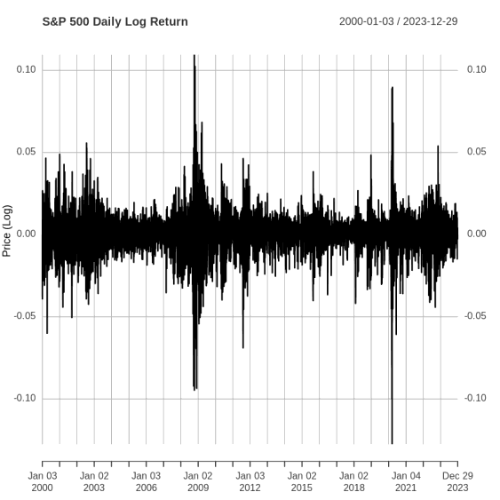

# S&P 500 Time-Series Analysis

Statistical analysis of daily log returns and ARIMA modelling in R. MSc time-series coursework, University of Greenwich.

## Question

What does the historical behaviour of the S&P 500 reveal about stationarity and short-run dependence, and how well can an ARIMA model describe the daily return series?

## Work completed

- Retrieved market data with `quantmod` for January 2000 to December 2023 and calculated daily log returns.
- Applied Augmented Dickey-Fuller and KPSS stationarity tests.
- Examined ACF/PACF plots and compared six ARIMA specifications using AIC and BIC.
- Evaluated an ARIMA(1,0,4) specification and discussed residual diagnostics, forecast performance and volatility limitations.

## What the project demonstrates

Data retrieval, transformations, statistical testing, model selection and critical interpretation. The report discusses why modelling return dependence does not by itself capture changing volatility, with GARCH identified as a possible extension.

## Explore the work

- [Portfolio report](portfolio-report.pdf).
- [R notebook](STAT1050_Code.ipynb).

## Run or inspect

The `.ipynb` file uses an **R kernel**, not Python. Saved outputs can be viewed on GitHub. To execute it locally:

1. Install R and a Jupyter environment with the IRkernel R kernel, or use another environment that supports R notebooks.
2. Install the packages imported by the notebook: `forecast`, `fpp2`, `tseries` and `quantmod`.
3. Open `STAT1050_Code.ipynb` with the R kernel and run cells in order.
4. The `getSymbols()` call retrieves `^GSPC` from Yahoo Finance and needs internet access. Provider availability and later data revisions can affect reproduction of saved results.

The original analysis is preserved. The workflow has not been freshly rerun, and the report's historical outputs should not be interpreted as demonstrated trading performance.

## Context

Academic analysis by Tejesh Ramesh Bawa. The preview is from the report. The portfolio PDF omits the student identifier.
